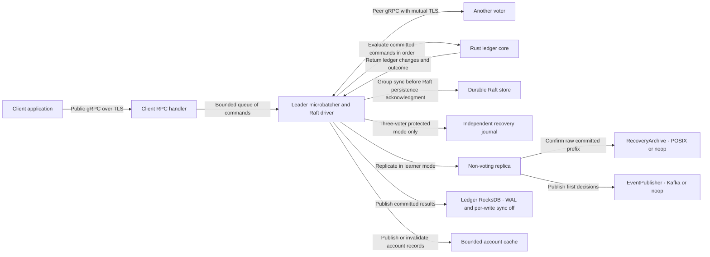

# Replicated double-entry ledger

The ledger uses Rust, TiKV's raft-rs and embedded RocksDB. Each RFC below owns one design question. **Settled** identifies a product requirement agreed in discussion. **Proposed** identifies a design that is still open for review.

## RFC index

| RFC | Design question | Decision so far |
| --- | --- | --- |
| [0001 · Accounts and postings](docs/rfcs/0001-accounts-and-postings.md) | What does a journal entry record? | One accepted posting creates an immutable entry of two or more balanced lines against accounts in the same ledger. |
| [0002 · Balance constraints](docs/rfcs/0002-balance-constraints.md) | How can an account enforce financial limits? | The ledger enforces configurable floors, ceilings and minimum available funds checks. |
| [0003 · Reservations](docs/rfcs/0003-reservations.md) | What happens to funds between authorization and settlement? | A partial capture requires the caller to keep or release the remaining hold. |
| [0004 · Funding waterfalls](docs/rfcs/0004-funding-waterfalls.md) | How does one payment consume several sources in priority order? | Every request supplies its source order. A posting or reservation funds the entire payment atomically. |
| [0005 · Request identity and retries](docs/rfcs/0005-request-identity.md) | How can clients safely retry a command whose reply was lost? | Each ledger retains the original decision by request ID, including resolved funding or rejection. |
| [0006 · Raft replication](docs/rfcs/0006-raft-replication.md) | How do replicas agree on command order and serve current reads? | A fixed three-voter group uses quorum-confirmed reads. Protected service requires a majority and the independent journal. Physical placement remains open. |
| [0007 · Durable recovery](docs/rfcs/0007-durable-recovery.md) | How does a replica recover after losing its unsynced ledger state? | Separate durable Raft storage from a WAL-disabled, unsynced ledger write path. Voters restart from a sealed local checkpoint plus the committed Raft tail. |
| [0008 · Peer transport](docs/rfcs/0008-peer-transport.md) | How do voters exchange messages and transfer snapshots? | Voters use mutual-TLS gRPC. Separate peer connections carry bounded checkpoint chunks and the missing committed command history. |
| [0009 · Public client protocol](docs/rfcs/0009-client-protocol.md) | How do clients submit commands and recover from lost replies across languages? | Backend services use the implemented `ledger.v1` mTLS API, protected reads and typed decisions. The Rust client routes retries across configured seeds. |
| [0010 · Account cache](docs/rfcs/0010-account-cache.md) | How do we avoid repeatedly loading hot accounts while serving consistent balances? | A byte-bounded cache serves decoded accounts. The owner updates resident rows when it publishes an applied batch and starts a fresh cache on a snapshot switch. |
| [0011 · Microbatching and group commit](docs/rfcs/0011-microbatching-and-group-commit.md) | How do independent payments share replication and disk costs? | The leader batches commands and groups Raft store syncs. RFC 0011 compares protected one-command and default operation on three local voters. |
| [0012 · Incremental snapshots](docs/rfcs/0012-incremental-snapshots.md) | How does a TB-scale voter restart or catch up? | Short gaps use ordinary Raft appends. Snapshot offers use verified replay from a local seal for bounded gaps with little file overlap, or a resumable physical image. The 1 TB drill is deferred for local development. |
| [0013 · Journal-based recovery](docs/rfcs/0013-daily-archive-backups.md) | Does local development need a separate daily archive? | The synchronous POSIX recovery journal covers acknowledged payments. Daily archives are out of scope. S3 or similar storage is a future journal option. |
| [0014 · Immutable ledger history](docs/rfcs/0014-immutable-ledger-history.md) | How can years of journal entries and request outcomes stay accessible without repeatedly copying them? | RocksDB stores ordered decision history separately from mutable state. Persistent indexes locate the original receipt and journal entry. Sealed segments remain proposed. |
| [0015 · Offsite commit protection](docs/rfcs/0015-offsite-commit-protection.md) | How does every acknowledged payment survive total loss of the voter disks? | Protected writes and quorum reads confirm an independent committed prefix. A fenced restore recovers that prefix after loss of all voters. Storage placement remains open. |
| [0016 · Journal checkpoints](docs/rfcs/0016-journal-checkpoints.md) | How can a replacement restore through the last protected acknowledgment without replaying from genesis? | A verified POSIX base contains full state and raw commands. Replacements apply the fenced journal tail. |
| [0017 · Physical Raft log reclamation](docs/rfcs/0017-raft-log-reclamation.md) | When may a voter delete old command bytes? | Pin a verified independent copy, durably switch the voter and compact the duplicate local records. |
| [0018 · Static Raft learner](docs/rfcs/0018-static-raft-learner.md) | How can quorum service continue during a backup outage? | Three voters commit and one non-voting learner follows. The client gets a quorum-applied decision. |
| [0019 · Asynchronous recovery archive](docs/rfcs/0019-async-recovery-archive.md) | Which independent prefix can recover a learner-backed deployment? | A learner worker verifies and advances an interchangeable archive of original committed bytes. POSIX and disabled adapters are available. |
| [0020 · Ledger decision publishing](docs/rfcs/0020-ledger-decision-publishing.md) | How do downstream consumers receive every first committed decision? | A separate worker publishes ordered versioned events through Kafka or a disabled adapter and maintains a destination cursor. |

## Node and network boundaries

The Rust stack uses `tokio` for networking and bounded queues, `tonic` for gRPC, and `prost` with `tonic-prost-build` for the service schemas. TiKV's `raft` crate drives consensus using its own internal message codec. The `rocksdb` crate supplies local storage. RFCs 0008 and 0009 describe the two wire protocols and the compatibility tests for these choices.
